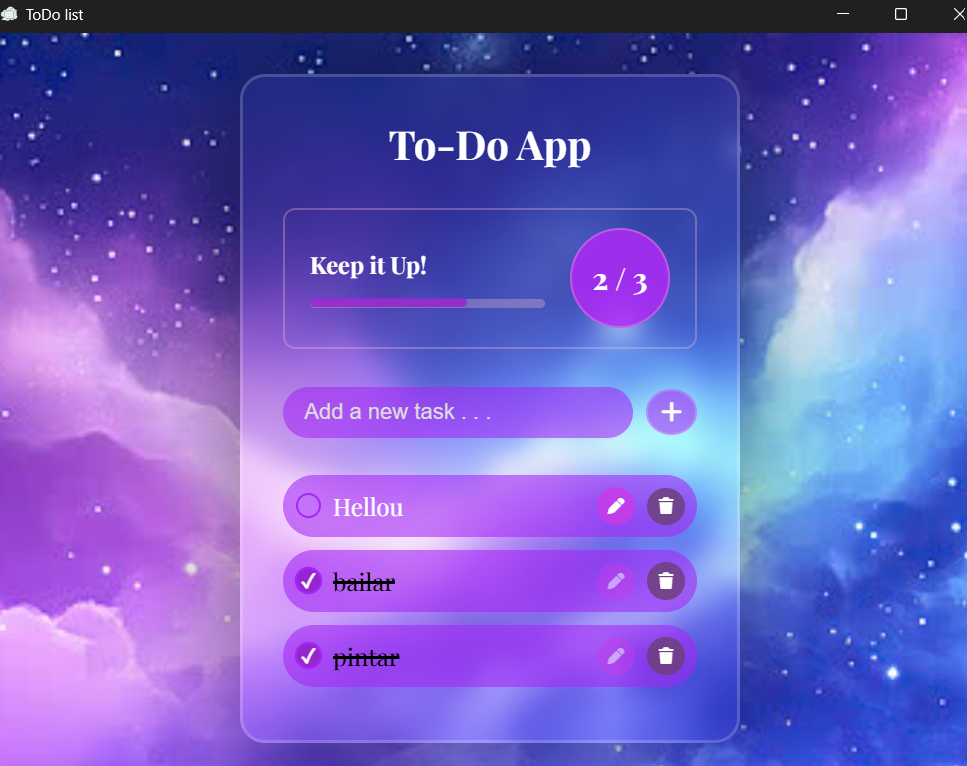

# To-Do List Desktop App

Una aplicación de gestión de tareas (To-Do List) moderna, elegante y 100% funcional sin conexión a internet. Construida con **HTML, CSS y JavaScript vainilla**, y empaquetada como una aplicación de escritorio nativa utilizando **Tauri**.


## Características:

*   **Interfaz Premium:** Diseño con efecto *Glassmorphism* (cristal), fondo espacial y tipografía elegante.
*   **Persistencia de Datos:** Las tareas se guardan localmente usando `localStorage`. Cierra la app y tus tareas seguirán ahí.
*   **Edición en Línea:** Haz clic en el lápiz para editar el texto directamente en la tarea, sin ventanas emergentes.
*   **Barra de Progreso:** Sigue tu progreso diario con un contador dinámico.
*   **Celebración:** ¡Confeti interactivo generado con `tsparticles` cuando completas todas tus tareas!
*   **100% Offline:** Todos los recursos (fuentes, iconos y librerías) están empaquetados localmente. No requiere internet para funcionar.

## Capturas de Pantalla



## Tecnologías Utilizadas

*   **Frontend:** HTML5, CSS3, JavaScript (ES6+).
*   **Empaquetado:** [Tauri](https://tauri.app/) (Rust).
*   **Iconos:** Font Awesome (local).
*   **Fuentes:** Google Fonts (Playfair Display, local).
*   **Efectos:** Tsparticles Confetti (local).

## Requisitos Previos

Para ejecutar este proyecto en tu entorno de desarrollo local, necesitarás:
*   [Node.js](https://nodejs.org/) (v16 o superior)
*   [Rust](https://www.rust-lang.org/tools/install)
*   [Tauri Prerequisites](https://tauri.app/v1/guides/getting-started/prerequisites) (Dependencias del sistema para Windows/macOS/Linux).

## Instalación y Desarrollo

1. Clona este repositorio:
   ```bash
   git clone https://github.com/DannaGA66/App_toDoList.git

2. Entra a la carpeta del proyecto:
    cd App_toDoList

3. Instala las dependencias de Tauri:
    npm install

4. Inicia el entorno de desarrollo (abrirá la ventana de la app):
    npx tauri dev

5. En caso de querer crear el .exe :
    npx tauri build